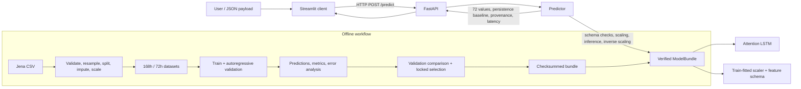

# Jena Climate Multi-Step Temperature Forecasting

An end-to-end portfolio project for forecasting hourly Jena temperature with three sequence-to-sequence neural architectures. It covers a leakage-aware data pipeline, reproducible training runs, validation-based model selection, traceable evaluation artifacts, checksummed model packaging, and a Streamlit-to-FastAPI inference prototype.

> **Task:** use 168 hours of observed weather to predict the next 72 hourly values of `T (degC)`. The selected validation candidate is an Attention LSTM. This repository includes a working inference bundle and demo stack; it is a research/portfolio prototype, not a production service.

## Contents

- [Problem and objectives](#problem-and-objectives)
- [Technology and architecture](#technology-and-architecture)
- [Dataset and preprocessing](#dataset-and-preprocessing)
- [Models and training](#models-and-training)
- [Experimental results](#experimental-results)
- [Inference demo](#inference-demo)
- [Installation and commands](#installation-and-commands)
- [Reproducibility and limitations](#reproducibility-and-limitations)
- [Project layout](#project-layout)
- [Future work](#future-work)

## Problem and objectives

Weather prediction is a multi-step time-series problem: forecast errors can accumulate as the horizon grows, and a useful comparison must account for temporal ordering, missing observations, and simple persistence behavior. This project compares encoder-decoder LSTM, additive-attention LSTM, and Transformer models under the same 168-hour input and 72-hour output contract.

The engineering objectives are to:

- preserve chronological train, validation, and test boundaries;
- fit preprocessing statistics on training data only;
- keep future targets out of validation, test, and inference model calls;
- select a candidate using validation metrics and bind it to its config and artifacts;
- serve forecasts from a verified model bundle through a small API and UI.

## Technology and architecture

Python 3.11–3.12, PyTorch, pandas, NumPy, scikit-learn, FastAPI, Pydantic, Streamlit, pytest, and Ruff. Versions are not fully locked; see [requirements.txt](requirements.txt) and [pyproject.toml](pyproject.toml).



The online path is implemented by [app/streamlit_app.py](app/streamlit_app.py), [api/main.py](api/main.py), [src/serving/predictor.py](src/serving/predictor.py), and [src/serving/bundle.py](src/serving/bundle.py). Streamlit sends the observation payload to FastAPI; the API loads the bundle at startup, and the Predictor validates, scales, calls the model autoregressively, inverse-scales the forecast to °C, and returns prediction records and provenance. Uploaded `future_actual`, when present, is used only for display and is not sent to the model.

## Dataset and preprocessing

The source is `jena_climate_2009_2016.csv`, registered in [data/raw/manifest.json](data/raw/manifest.json) with the Kaggle dataset slug `mnassrib/jena-climate` and an expected SHA-256. It contains 420,551 source rows, 14 meteorological variables, and timestamps at 10-minute intervals. Raw data is intentionally not committed; the dataset README explains the local data policy.

| Step | Implementation | Why it matters |
|---|---|---|
| Validate and clean timestamps | Enforce the expected 15-column schema, parse and sort timestamps, drop exact duplicate rows; conflicting duplicate timestamps are averaged defensively. | Establishes a consistent chronological index and prevents duplicate records from distorting aggregation. |
| Handle invalid readings | Convert configured `-9999` wind-sensor sentinels to missing values before resampling. | Prevents invalid codes from contaminating hourly statistics. |
| Resample to hourly | Mean for continuous variables, maximum for `max. wv (m/s)`, circular mean for wind direction. | Matches the hourly forecast cadence while respecting variable semantics; circular averaging avoids the 0°/360° discontinuity. |
| Add time features | Add sine/cosine encodings for hour-of-day and day-of-year. | Represents cyclical calendar structure without an artificial boundary jump. |
| Split chronologically | 70% train, 15% validation, 15% test by ordered hourly rows; the data artifact spans 2009-01-01 through 2017-01-01. | Makes evaluation reflect forecasting into later time periods and prevents windows crossing split boundaries. |
| Handle missing values | Forward-fill input features up to 3 hours, independently within each split. No backward-fill or interpolation. Never impute the target. Reject any window containing NaN or Inf. | Uses only past information for short input gaps and avoids manufacturing future labels or crossing a split boundary. |
| Normalize | Fit `StandardScaler` on train rows only and transform all splits. Fourteen missingness flags are retained as diagnostics but excluded from model inputs and scaling. | Prevents validation/test distribution statistics from leaking into training while retaining missingness evidence for audits. |
| Build windows | Model schema contains 18 features: 14 raw numeric weather features plus four cyclical time features. `T (degC)` is the prediction target. Input is 168 hours; target is the following 72 hours. | Gives every model the same tensor interface and temporal target alignment. |

The dataset implementation applies a configured stride. The recorded experiments use stride 6 for training (sample every sixth valid overlapping start) and stride 1 for validation, which yields 10,026 validation windows per model. This is not full-overlap training. The locked schema and preprocessing policy are in [configs/data.yaml](configs/data.yaml) and [artifacts/preprocessing/feature_schema.json](artifacts/preprocessing/feature_schema.json); the batch contract is `float32 [B,168,n_features]` for `x`, `float32 [B,72,1]` for `y`, and aligned `int64` timestamps.

## Models and training

All models implement `forward(x, y=None, teacher_forcing_ratio=0.0)` and return `[B,72,1]`. They initialize the decoder with the final observed target value, with target index and feature count resolved from schema/config rather than fixed inside shared consumers. Teacher forcing is available only in training; validation and inference use `y=None` and ratio `0.0`.

| Model | Implementation | Architecture and recorded configuration |
|---|---|---|
| Seq2Seq LSTM | [src/models/seq2seq_lstm.py](src/models/seq2seq_lstm.py) | One-layer encoder and decoder LSTMs, hidden size 128, dropout 0.0. Encoder final hidden and cell states initialize the autoregressive scalar decoder. Training config sets teacher forcing to 0.5 with 0.05 per-epoch decay. |
| Attention LSTM | [src/models/attention_lstm_seq2seq.py](src/models/attention_lstm_seq2seq.py), [src/models/attention.py](src/models/attention.py) | One-layer encoder/decoder LSTMs, hidden size 128, dropout 0.0. Bahdanau additive attention scores all 168 encoder outputs at every decoder step from the previous top-layer decoder hidden state. The weighted context enters the decoder and is fused with its output for prediction. Weights are exposed separately for diagnostics. |
| Transformer | [src/models/transformer.py](src/models/transformer.py) | Encoder-decoder Transformer, `d_model=64`, 4 heads, 2 encoder and 2 decoder layers, feed-forward size 256, dropout 0.1, GELU, pre-norm, and sinusoidal positions. A causal decoder mask blocks access to later decoder positions. Training config uses full teacher forcing (1.0); validation/inference are autoregressive. |

The recorded training runs use seed 42, batch size 64, Adam, learning rate 0.001, weight decay 0.0001, MSE loss, gradient clipping at 1.0, and validation-loss early stopping with patience 5. The per-model configured epoch budget is in [configs/](configs/); registry records show 15 epochs completed for Seq2Seq LSTM, 8 for Attention LSTM, and 10 for Transformer. These runs were performed on CPU according to the project workflow record. Training computes MSE on standardized targets; the evaluation pipeline inverse-scales predictions and labels before reporting °C metrics.

Training orchestration and callbacks are in [src/training/trainer.py](src/training/trainer.py) and [src/training/callbacks.py](src/training/callbacks.py). The CLI creates run metadata, resolved config, logs, and best/last checkpoints. Validation calls are autoregressive and are the basis for early stopping/checkpoint selection.

## Experimental results

Three recorded real-data validation runs share the same schema, train-fitted scaler, 168/72 window contract, and 10,026-window validation population (`jena_validation_fac7f994f7f54901_in168_out72`). Model selection uses validation RMSE in °C. The persistence baseline repeats the final observed temperature through the horizon.

| Validation model | MAE (°C) | MSE (°C²) | RMSE (°C) | RMSE reduction vs. persistence |
|---|---:|---:|---:|---:|
| Attention LSTM — selected | 2.620241 | 11.487950 | **3.389388** | 35.35% |
| Seq2Seq LSTM | **2.617508** | 11.530652 | 3.395681 | 35.23% |
| Transformer | 3.593824 | 22.563722 | 4.750129 | 9.40% |
| Persistence baseline | 3.986390 | 27.489547 | 5.243047 | — |

Attention LSTM was selected because it had the lowest validation RMSE and cleared the configured 3% baseline-improvement gate. Seq2Seq LSTM has slightly lower validation MAE, but model selection was defined by RMSE. The comparison table and plot are [experiments/validation_comparison.csv](experiments/validation_comparison.csv) and [experiments/validation_comparison.png](experiments/validation_comparison.png). The selection is bound in [experiments/selection_manifest.json](experiments/selection_manifest.json).

| Locked Attention LSTM evaluation | MAE (°C) | MSE (°C²) | RMSE (°C) | Windows |
|---|---:|---:|---:|---:|
| Validation | 2.620241 | 11.487950 | 3.389388 | 10,026 |
| Final test | 2.721700 | 12.300567 | 3.507216 | 9,969 |

The repository documents that the test split was accessed during an earlier invalid development iteration. The current candidate was selected from validation and the recorded selection manifest says test metrics were not used to select it. The reported final-test metrics are therefore useful as a qualified retrospective result, but the test split is **not a pristine unseen holdout**. See [experiments/final_test_audit.json](experiments/final_test_audit.json) and [docs/EVALUATION_DEMO.md](docs/EVALUATION_DEMO.md). Evaluation produces overall and per-horizon metrics, persistence comparison, error-by-hour/season outputs where timestamp data supports them, worst cases, residuals, and forecast figures. It does not provide a three-model test comparison; only the selected candidate has a recorded final-test evaluation.

## Inference demo

The versioned bundle in `bundle/seq2seq_attention/` contains the Attention LSTM weights, scaler, feature schema, resolved and preprocessing configs, selection manifest, final-test audit, metadata, and a SHA-256 manifest. Bundle loading verifies file checksums, metadata bindings, schema, and strict model-state loading before inference. A separate release bundle is required for a clean clone; the weights are intentionally excluded from Git. The bundle present in this workspace passed `verify_bundle` during this documentation audit.

FastAPI validates the request through Pydantic and Predictor checks that there are exactly 168 hourly timestamps and observations with the exact feature names and schema order. Non-finite values and invalid cadence are rejected. The Predictor standardizes inputs using the bundled scaler, calls the model without target data, inverse-scales the 72 predictions to °C, and returns timestamps, model/run provenance, latency, a persistence forecast, and Attention LSTM weights. Input validation failures return HTTP 422; unavailable bundle state returns 503. The Streamlit app only calls the HTTP API and does not load model weights locally.

This is a local demo prototype: it has no authentication, deployment configuration, traffic controls, monitoring, or operational service-level guarantees. The bundle is labeled as a production release artifact in metadata, but the application itself should not be described as a production deployment.

## Installation and commands

Use Python 3.11 or 3.12. Create an environment, install project dependencies, and obtain the separately delivered release bundle. The raw dataset is needed for preprocessing and real-data retraining, but is not needed to run the inference stack.

```bash
python3.11 -m venv .venv
source .venv/bin/activate
python -m pip install --upgrade pip
python -m pip install -r requirements.txt
```

Verify and run the bundled demo:

```bash
python -c "from pathlib import Path; from src.serving.bundle import verify_bundle; verify_bundle(Path('bundle/seq2seq_attention')); print('PASS')"
python scripts/run_stack.py --bundle bundle/seq2seq_attention
```

Then open `http://127.0.0.1:8501`. Upload a JSON payload with `timestamps` and `observations` containing 168 hourly rows in schema feature order. A real train or validation payload can be generated locally after obtaining the raw CSV:

```bash
python scripts/prepare_data.py
python -m src.data.preprocessing
python scripts/generate_demo_payload.py --raw-csv data/raw/jena_climate_2009_2016.csv --schema artifacts/preprocessing/feature_schema.json --split validation --output /tmp/jena-validation-demo.json
```

`prepare_data.py` verifies the registered raw-file hash and downloads from the declared Kaggle source when needed; downloading requires the Kaggle CLI and credentials. The preprocessing module writes processed splits and scaler/schema metadata. For real-data training, use the run commands recorded in [docs/WORKFLOW.md](docs/WORKFLOW.md):

```bash
python scripts/train.py --config configs/lstm.yaml --device cpu --data-dir data/processed --runs-dir runs
python scripts/train.py --config configs/attention.yaml --device cpu --data-dir data/processed --runs-dir runs
python scripts/train.py --config configs/transformer.yaml --device cpu --data-dir data/processed --runs-dir runs
```

The training CLI requires processed train/validation CSVs and preprocessing artifacts. It does not use the test split. Evaluation and comparison CLIs accept prediction/metadata artifacts rather than silently generating predictions or retraining; their exact arguments and selection protocol are documented in [docs/EVALUATION_DEMO.md](docs/EVALUATION_DEMO.md). The source audit environment currently uses Python 3.14 without PyTorch, so training CLI execution was not verified here; commands above match the checked script interfaces and require the supported environment and data prerequisites.

## Reproducibility and limitations

- Seed 42 is applied to Python, NumPy, PyTorch, and CUDA/cuDNN when available. Exact determinism can still depend on hardware and backend operations.
- The registry, validation comparison, locked selection manifest, final-test audit, prediction metadata, configs, schema/scaler hashes, and bundle checksums provide traceability. Run folders and datasets may be local or separately delivered and are not all present in every clone.
- The current feature schema has 18 model features; downstream model construction reads the feature order/count and target index from schema/config.
- The bundle checksum check passed in the audit environment, with a scikit-learn warning because the serialized scaler was created with 1.9.1 while the active environment had 1.9.0. Use a supported, dependency-matched environment for reliable deserialization.
- `requirements.txt` does not pin most dependencies, and the repository has no lockfile. Python 3.14 is outside the `pyproject.toml` Python range. Install and verify in Python 3.11 or 3.12.
- [AGENTS.md](AGENTS.md) and some role playbooks still describe the models, training, evaluation, or serving as unimplemented scaffolds. Current source, tests, experiment artifacts, and the demo bundle show implementations exist. Those status notes are stale and should be reconciled separately.
- Existing tests cover data contracts, model shapes, training behavior, evaluation, bundle integrity, serving, and the API/demo. The repository’s [codebase audit](docs/CODEBASE_AUDIT.md) records a past run of 374 passed and 24 skipped; tests were not rerun as part of this documentation audit.

Detailed protocol and artifact provenance: [docs/EXPERIMENT_RULES.md](docs/EXPERIMENT_RULES.md), [docs/EVALUATION_DEMO.md](docs/EVALUATION_DEMO.md), [experiments/conclusions.md](experiments/conclusions.md), and [docs/CODEBASE_AUDIT.md](docs/CODEBASE_AUDIT.md).

## Project layout

| Path | Contents |
|---|---|
| `src/data/` | Source validation, preprocessing, chronological splits, window datasets, and data loaders. |
| `src/models/` | Seq2Seq LSTM, Bahdanau Attention LSTM, Transformer, and baselines. |
| `src/training/` | Training loop, loss factory, early stopping, checkpoint, and metric callbacks. |
| `src/evaluation/` | Metrics, validation selection registry, error analysis, and figures. |
| `src/serving/` | Versioned bundle verification/loading, inference Predictor, and schemas. |
| `configs/` | Data policy, shared training settings, and architecture-specific configs. |
| `scripts/` | Data acquisition, training, prediction/evaluation, comparison, export, and demo entry points. |
| `api/`, `app/` | FastAPI backend and Streamlit HTTP client. |
| `experiments/`, `artifacts/` | Validation/test evidence, metrics, predictions, figures, schemas, and audit metadata. |
| `bundle/` | Separately delivered model bundle; trained weights are excluded from Git. |
| `tests/` | Automated checks for the data, models, training, evaluation, bundle, and serving contracts. |
| `docs/`, `agents/` | Experiment protocol, evaluation guide, codebase audit, and development guidance. |

## Future work

- Re-establish a pristine test protocol for future model development, with a newly reserved temporal holdout or rolling-origin evaluation.
- Add repeated-seed runs and uncertainty intervals before drawing broad generalization conclusions.
- Tune all architectures under a documented compute budget and compare against seasonal-naive baselines as well as persistence.
- Pin dependencies and add a clean Python 3.11/3.12 environment check for bundle loading and the demo.
- Reconcile stale scaffold-status documentation with the current implementation and define deployment hardening requirements before production use.
